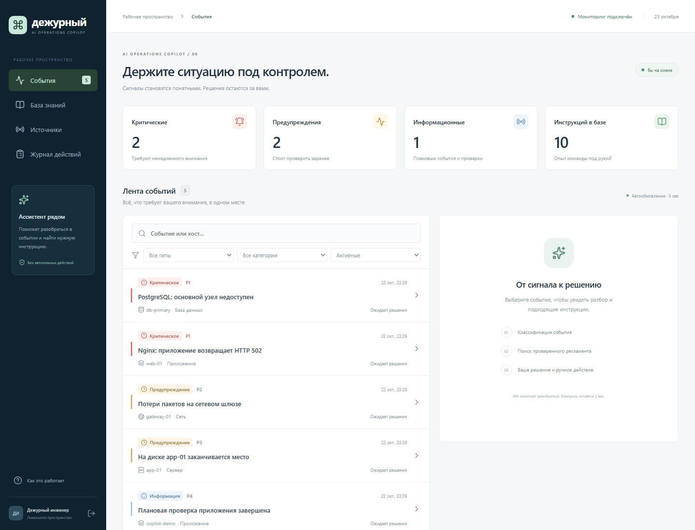

# Сигналис · ИИ-Ассистент Дежурного

Приложение с публичным демонстрационным стендом и локальным запуском для **кейса 8**: получает события настоящего Prometheus,
определяет тип, категорию и приоритет, находит подходящие регламенты и помогает инженеру
принять решение. Приложение **не выполняет команды на инфраструктуре**.

**Команда «Дейкстра»:** Диль Роман, Мадаминов Дамир, Родиков Глеб, Шабалин Максим, Иудин Никита.

Проект предназначен для внутренней инженерной работы B2B-Center. Визуальная система
использует графитовую, белую и красную палитру и геометрические акценты сайта B2B-Center;
данные и рабочие сценарии приложения остаются отдельными.



## Версия для сдачи 13 ноября 2026

Дополнительные задачи A/B входят в текущие исходники: исправления классификации, объяснения и оценки рекомендаций, аудит и экспорт. Репозиторий: `Roman4588/B2B_8case`, основная ветка `main`. Состояние облачного развёртывания проверяйте отдельно по SHA в Amvera и фактическим пользовательским сценариям.
Статус, ограничения и команды: [финальная приёмка](docs/final-readiness.md).
[Демонстрация A/B за 5–7 минут](docs/demo-script.md) · [Порядок доставки и безопасного обновления](docs/github-amvera-sync-2026-11-12.md).

## Запуск актуального комплекта

Нужны Docker Engine / Docker Desktop с Compose и WSL 2 на Windows, интернет для первой сборки,
4 ядра, от 8 ГБ RAM и рекомендуемые 20 ГБ свободного места на диске Docker.
GPU и платные ключи не нужны.

```bash
git clone https://github.com/Roman4588/B2B_8case.git
cd B2B_8case
docker compose up --build -d
```

Windows: можно дважды нажать **Запустить.cmd**. Скрипт проверяет Docker,
запускает контейнеры и ждёт подготовки модели. Docker Desktop должен оставаться запущенным.
Первый запуск может занять 10–30 минут в зависимости от загрузки образов и модели. В текущей приёмке — около 16 минут с кешем Docker-слоёв и пустыми томами; полностью холодная загрузка всех образов не измерялась. Интернет нужен к Docker Hub, PyPI, npm и Hugging Face/CDN. Автономная демонстрация без интернета в этом комплекте не заявляется.

Первого администратора создайте в терминале:

```bash
docker compose exec api python -m app.manage create-admin
```

Введите email, имя, пароль длиной 12–128 символов с буквами и цифрами, затем повторите пароль.
Символы пароля при вводе не отображаются. Если аккаунт уже существует, используйте
`docker compose exec api python -m app.manage reset-password`.

Откройте **http://localhost:8080**. Документация API: **http://localhost:8080/api/docs**.
В «Источниках» отдельно видны готовность базы знаний и связь с Prometheus.
Копирование `.env.example` для учебного стенда не обязательно.

**[Проверка за 5–7 минут](docs/reviewer-guide.md)** ·
**[Тестовый документ](examples/reviewer-queue.json)** ·
**[Видео команды](docs/media/signalis-presentation.mp4)** ·

Остановка без удаления данных: `docker compose down`.
Не добавляйте `-v`: это удалит тома с данными.

## Публичный стенд Amvera

1. Откройте **[публичный сайт «Сигналис»](https://b2b-madaminchyk.mia0.amvera.tech/)**.
2. Введите данные демонстрационного администратора:

- **Email:** `adminka@mail.ru`
- **Пароль:** `Signalis2026Admin`

3. Нажмите **«Войти»**. Аккаунт уже создан; регистрация и доступ к почтовому ящику не нужны.
4. Откройте «Источники» → «Аварийные события», затем «События» и рекомендацию.
5. Для проверки загрузки используйте [тестовую инструкцию](examples/reviewer-queue.json).

Это общий публичный аккаунт администратора учебного стенда с полным доступом к его данным и пользователям. Пожалуйста, не меняйте пароль общего аккаунта и не удаляйте данные других проверяющих. Для просмотра и проверки функций отдельная установка Docker не требуется.

**[Сценарий проверки за 5–7 минут](docs/reviewer-guide.md)** · **[Видео](docs/media/signalis-presentation.mp4)**

## Публичное размещение

**[Рабочий демонстрационный стенд «Сигналис»](https://b2b-madaminchyk.mia0.amvera.tech/)** — размещён в Amvera.

30–31 октября 2026 через публичный адрес проверены вход инженера, настоящий Prometheus, рекомендации, ручной журнал, JSON/Markdown, поиск и фоновый PDF-импорт 60 страниц. Проверены сохранность аккаунтов и инструкций после перезапуска, ошибка и автоматическое восстановление источника. Данные общего демонстрационного администратора приведены в разделе «Для проверяющих: вход без установки».

[Отчёт со всеми 21 проверками, commit, стоимостью, доказательствами и ограничениями](docs/amvera-deployment-2026-10-30.md). [Конфигурация Amvera](docs/deployment-amvera.md). Стенд предназначен для небольшой демонстрационной нагрузки; многопользовательская нагрузка не подтверждена. История метрик Prometheus временная; данные приложения и файлы сохраняются в /data.

## Что умеет приложение

- Получает firing alerts через `GET /api/v1/alerts` Prometheus каждые 15 секунд.
- Объединяет повторные события и отмечает восстановление только после успешного опроса.
- Определяет тип **критическое / предупреждение / информационное**, категорию
  **сервер / сеть / БД / приложение** и приоритет **P1–P4**.
- Использует проверенные метки мониторинга, объяснимые правила и обученную текстовую модель.
  Слабый сигнал текстовой модели и неоднозначные формулировки требуют ручной проверки.
  Фиксированные проценты для правил не показываются как вероятность правильности.
- Ищет инструкции по смыслу на русском и английском через **реальные эмбеддинги и pgvector**.
  Показывает источник, редакцию, шаги и предостережения. Сходство — не вероятность правильности.
- Позволяет создать, отредактировать и загрузить регламенты «Если X → Y».
- Администратор может удалить отдельную инструкцию или исходный файл со всеми инструкциями из его импорта. Перед удалением требуется подтверждение; действие сохраняется в журнале. Выполняющийся импорт сначала должен завершиться.
- Принимает **JSON, MD, TXT, текстовые PDF и DOCX** до 25 МБ; обработка выполняется в фоне.
  Скан без текста требует предварительного OCR. Для файлов есть прогресс, ошибка и повтор.
- Сохраняет решения инженера, комментарии, профиль и журнал аудита.
- Показывает историю решений по конкретному эпизоду прямо в карточке события.
- Сохраняет повторные аварии отдельными эпизодами и использует время начала из Prometheus.
- Показывает устаревшее подключение после минуты без успешного опроса.
- Прерывает зависший запрос через 30 секунд, показывает ошибку связи и продолжает автообновление.
- Скрывает прежние рекомендации при пересчёте; при ошибке поиска предлагает повтор.
- Даёт переключать синтетические аварии, предупреждения и восстановление в учебном стенде.

Приоритеты: critical → P1; warning с `impact=high` → P2;
прочие warning → P3; info → P4. Правило не зависит от произвольной метки `priority`.

Ручной процесс: **«Принято к ручному выполнению» → самостоятельное действие инженера →
«Выполнено вручную»**. Кнопки меняют только запись в приложении.
Статус мониторинга и статус ручной работы учитываются отдельно.

## Примеры и API

Примеры регламентов: [JSON](examples/runbooks.json) и [Markdown](examples/if-then.md).
В интерфейсе откройте «База знаний» → «Загрузить документ».

Примеры ниже для curl; в Windows PowerShell используйте `curl.exe`.

```bash
curl -c copilot.cookies -H 'Content-Type: application/json' \
  -d '{"email":"admin@example.org","password":"ВАШ_ПАРОЛЬ"}' http://localhost:8080/api/auth/login

curl -b copilot.cookies 'http://localhost:8080/api/incidents?state=firing&category=database'

curl -b copilot.cookies -F 'file=@examples/runbooks.json' \
  http://localhost:8080/api/runbooks/import

curl -b copilot.cookies http://localhost:8080/api/jobs/JOB_ID

curl -b copilot.cookies -H 'Content-Type: application/json' \
  -d '{"action":"accept","comment":"Проверю узел вручную"}' \
  http://localhost:8080/api/incidents/INCIDENT_ID/actions

curl -b copilot.cookies http://localhost:8080/api/audit

curl -b copilot.cookies http://localhost:8080/api/incidents/INCIDENT_ID/history
```

Загрузка возвращает **HTTP 202** и идентификатор задания. Ожидать завершения обработки
в HTTP-соединении не нужно; результат доступен по `/api/jobs/{id}`.

## Свой Prometheus

Создайте `.env` из `.env.example` и задайте:

```dotenv
DEMO_MODE=false
PROMETHEUS_URL=https://monitoring.example.org
PROMETHEUS_TOKEN=your-read-only-token
```

Пересоздайте сервисы: `docker compose up -d`.
Адрес должен быть доступен из контейнера; `localhost` внутри контейнера означает сам контейнер.
Проверка TLS включена. Используйте токен только для чтения.
Обязательная структура ответа — стандартный Prometheus Alerts API.
Желательные labels: `severity`, `category`, `host`/`instance`, `impact`;
annotations: `summary`, `description`. Отсутствующие тип и категория определяются из текста.

Внешний Zabbix не нужен: критерий кейса допускает **Zabbix или Prometheus**,
и проект реализует интеграцию Prometheus.

## Устройство проекта

**React + TypeScript + Vite → Nginx → FastAPI → PostgreSQL 17 + pgvector.**
Celery с Redis обрабатывает документы, индексирует регламенты и опрашивает Prometheus.
FastEmbed / ONNX Runtime запускает локально
`sentence-transformers/paraphrase-multilingual-MiniLM-L12-v2` (384 измерения).
Текстовый классификатор использует TF-IDF и Logistic Regression; обучение отделено от проверки.
Тяжёлый PyTorch и генеративный облачный LLM не требуются.

| Каталог | Содержание |
|---|---|
| `backend/app/` | API, модели, классификация, поиск, импорт, фоновые задачи |
| `backend/migrations/` | Миграции Alembic |
| `backend/tests/` | Модульные, API и PostgreSQL-интеграционные проверки |
| `frontend/src/` | Адаптивный интерфейс на русском |
| `frontend/e2e/` | Браузерные тесты Playwright |
| `deploy/` | Nginx, настоящий Prometheus и учебный экспортёр метрик |
| `datasets/` | Отдельный проверочный набор и описание его ограничений |
| `scripts/` | Запуск, остановка и сквозная проверка |
| `docs/` | Результаты приёмки, видео и документация |

## Проверки

Изменения надёжности, миграция существующей базы и границы проверок описаны в
[отчёте доработки](docs/reliability.md).
Последующий аудит PR №1, исправления гонок, история решений и фактические результаты
проверок — в [отчёте 24–27 октября](docs/review-2026-10-27.md).

```bash
# Запущенный стенд + настоящая БД и модель:
docker compose --profile test run --build --rm tests

# Оценка классификатора на замороженном наборе:
docker compose --profile test run --rm --no-deps tests \
  python scripts/evaluate.py --output /tmp/classification-report.json

# Сквозной HTTP-тест, включая PDF на 60 страниц:
python -m pip install -r backend/requirements-dev.txt
# Укажите реквизиты созданного тестового пользователя:
# PowerShell: $env:E2E_EMAIL='e2e@example.org'; $env:E2E_PASSWORD='Only-for-tests-2026'
python scripts/smoke.py

# Проверка интерфейса:
cd frontend
npm ci
npx playwright install chromium
npm run build
npm run test:e2e
```

Оценка классификации возвращает ненулевой код, если точность всей тройки ниже 90%.
Проверочный набор создан авторами проекта и не используется для обучения.
Это **не независимый датасет организаторов**: результат на неизвестных событиях заранее не гарантируется.
Фактические метрики: [отчёт классификации](docs/classification-report.json),
[сквозная проверка](docs/smoke-report.json), [матрица требований](docs/acceptance.md).

## Видео для сдачи

[Видеопрезентация команды «Дейкстра»](docs/media/signalis-presentation.mp4) — представление команды,
архитектура и демонстрация приложения: **4:49,9, Full HD, 30 кадров/с**.

[Скачать MP4](https://github.com/Roman4588/B2B_8case/raw/refs/heads/main/docs/media/signalis-presentation.mp4) ·
[Русские субтитры SRT](docs/media/signalis-presentation.srt) ·
[Материалы и проверка видео](docs/video-presentation.md). Это запись прежнего интерфейса: новые исправления классификации, оценки полезности и экспорт в ней не показаны. Для задач A/B используйте текущий комплект и [живую демонстрацию](docs/demo-script.md).

## Если что-то не запускается

- **8080 занят:** задайте `APP_PORT=8081` в `.env` и используйте новый адрес.
- **Модель ещё загружается:** подождите или проверьте `docker compose logs --tail=100 worker`.
  Если загрузка не удалась, проверьте доступ к Hugging Face и нажмите «Повторить» у инструкции.
- **Нет событий:** откройте «Источники», выберите «Аварийные события», подождите до 30 секунд.
- **Источник недоступен:** активные инциденты сохраняются; проверьте адрес, токен и связь.
- **Импорт завершился ошибкой:** причина видна рядом с заданием; исправьте файл и повторите.
- **Документ является сканом:** сначала распознайте текст, затем загрузите его.
- **PowerShell запрещает скрипт:** используйте `Запустить.cmd` либо команду
  `powershell -NoProfile -ExecutionPolicy Bypass -File .\scripts\start.ps1 -Background`.
- **Другой Windows-компьютер без Docker:** установите Docker Desktop по
  [официальной инструкции](https://docs.docker.com/desktop/setup/install/windows-install/),
  включите WSL 2 и направьте Docker disk image на диск с достаточным местом.


Это локальный демонстрационный стенд: порт опубликован только на `127.0.0.1`.
Для внешнего размещения нужны собственные реквизиты, HTTPS и настройки доступа.
Для локальной копии первый администратор создаётся командой выше. Публичные реквизиты в начале README относятся только к учебному стенду Amvera.
Файлы `.env`, cookies, модель и контейнерные данные не попадают в GitHub. Ограничения демонстрационного размещения описаны выше.


## Исправления классификации и полезность рекомендаций

В карточке события нажмите **«Исправить классификацию»**, выберите тип, категорию и любой приоритет P1–P4; комментарий необязателен. Карточка, список, фильтры, сортировка по приоритету и сводка используют ручные значения. Отметка показывает автора и время. Автоматический разбор доступен отдельно; его уверенность не относится к решению инженера.

Исправление относится к одному эпизоду (`incidents.id`). Повторный опрос и изменение описания сохраняют его; новый эпизод, в том числе обнаруженный по новому `activeAt`, начинается без исправления. На эпизод хранится одна текущая правка, повторное редактирование обновляет её и снимок входных данных. Конкурентные правки последовательно применяются под блокировкой эпизода; действует последняя сохранённая. Идентичный запрос не меняет автора/время и не создаёт аудит. Изменение и аудит сохраняются одной транзакцией.

Рекомендация показывает прямые совпадения слов события **с условием** регламента и семантическое сходство существующего поиска: `1 − cosine distance` ближайшего фрагмента, с прежним порогом 0,38. Лексический сигнал — пересечение нормализованных слов русского/английского текста (регистр, Unicode, пунктуация, `ё/е`, стоп-слова). Это точные слова без морфологического анализа; отсутствие общих слов явно показывается. Совпадения не являются объяснением внутреннего решения векторной модели, сходство не является вероятностью правильности и не даёт пословных оценок.

Кнопки **«Помогла» / «Не помогла»** оценивают рекомендацию, не меняя статус мониторинга или ручного выполнения. Единица оценки: **инженер + эпизод + регламент + редакция**. Повтор не увеличивает счётчик, смена оценки обновляет запись. Сохраняются автор, время, поколение и неизменяемый снимок первоначально оценённой рекомендации. Исторический ID регламента не имеет внешнего ключа на живую запись: существующее удаление регламента или импортированного документа не блокируется, а оценка, редакция и снимок сохраняются. В сводке удалённые регламенты не отображаются. После пересчёта той же редакции оценка остаётся общей для этой единицы; новая редакция оценивается отдельно. Запрос принимается только для реально опубликованной в эпизоде рекомендации с указанными редакцией и текущим `recommendation_generation`; устаревший запрос получает 409. В «Базе знаний» backend считает «Помогла» и «Не помогла», включая нули, **по всем редакциям** каждого регламента. Изменения доступны в журнале и истории эпизода, включая прежние/новые значения.

API использует существующие cookie-сессии и проверку Origin:

- `PUT /api/incidents/{id}/classification`: `severity`, `category`, `priority`, `comment`.
- `PUT /api/incidents/{id}/recommendations/{book_id}/feedback`: булево `helpful`, целочисленные `revision` и `generation` из карточки. Автор всегда определяется сессией.

## Запуск и экспорт

Из корня переданного комплекта (папка автора: `F:\B2B_8case`) запуск сохраняется одной командой. `init` автоматически применяет новую миграцию Alembic `0004` после существующих миграций; старые миграции не меняются:

```powershell
docker compose up --build -d
```

Выгрузка текущих исправлений одной командой через существующий Compose:

```powershell
docker compose exec -T api python scripts/export_corrections.py --output /data/uploads/corrections.json
```

Формат — JSON-массив `title`, `description`, `labels`, эталонных `severity/category/priority` и `provenance`. Используется снимок на момент последнего реального изменения правки. В происхождении остаются ID эпизода/правки и время; имена, email, ID сотрудников, комментарии и хосты отдельно не выгружаются. Метки ограничены известными значениями `severity/category/impact`; URL, email, ключи, токены и пароли распространённых форматов в тексте скрываются. Произвольные секреты в свободном тексте не всегда распознаваемы: перед передачей корпуса за пределы своей системы проверьте обезличивание. Очистка может изменить вход классификатора; это ограничение записывается в отчёт.

Пересчёт метрик **исходного автоматического `classify()`**, а не ручных значений:

```powershell
docker compose exec -T api python scripts/evaluate.py --dataset /data/uploads/corrections.json --output /data/uploads/corrections-metrics.json
```

Пустая выгрузка — `[]`; оценка сообщает, что метрики не рассчитаны (`metrics: {}`, `passed: null`, код выхода 0). Для непустого корпуса код 1 означает точность тройки ниже прежнего порога 0,9; корпус исправлений специально содержит обнаруженные ошибки и не является несмещённым бенчмарком. Матрицы учитывают также классы, предсказанные моделью, но отсутствующие в эталонах. Никакого переобучения нет; `datasets/evaluation.json` и `training.json` не изменяются и не смешиваются с экспортом. Файлы находятся в существующем томе `uploads`; при необходимости скопируйте их через `docker compose cp api:/data/uploads/corrections.json ./corrections.json`.

## Проверка на отдельном окружении

Не запускайте интеграционные тесты с адресом рабочей БД. Для изолированного полного стека используйте отдельное имя Compose-проекта, порт и новые тома:

```powershell
$env:APP_PORT = '18095'
docker compose -p signalis-final-20261112 up --build -d
docker compose -p signalis-final-20261112 --profile test run --build --rm tests
docker compose -p signalis-final-20261112 exec api python -m app.manage create-admin
```

Интеграционные тесты конкурентности дополнительно создают отдельные базы `case8_test_<uuid>` и удаляют только эти временные базы. Проверка миграции выполняется на PostgreSQL с существующим событием и аудитом. Обычные тесты используют SQLite; они не заменяют проверку ограничений и блокировок PostgreSQL.

Для frontend (укажите данные созданной **тестовой** учётной записи):

```powershell
cd frontend
npm ci
npm run build
npx playwright install chromium
$env:BASE_URL = 'http://localhost:18095'
$env:E2E_EMAIL = 'e2e@example.org'
$env:E2E_PASSWORD = 'Only-for-tests-2026'
npm run test:e2e
```

`operator.spec.ts` и `feedback-live.spec.ts` проверяют реальный стек; `reliability.spec.ts` и `feedback.spec.ts` используют управляемые API-ответы для воспроизведения ошибок и задержек. На Windows можно использовать установленный Edge: `$env:PLAYWRIGHT_CHANNEL = 'msedge'`. Остановка тестового стека без удаления томов: `docker compose -p signalis-final-20261112 down`.

