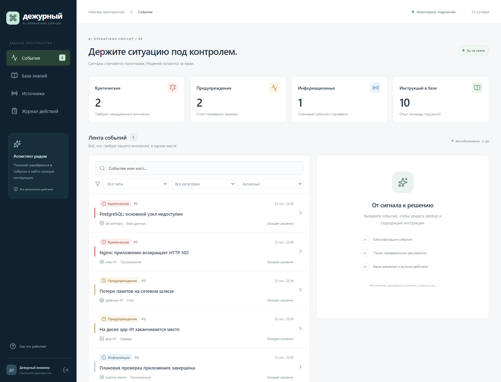

# Сигналис · ИИ-Ассистент Дежурного

Готовое локальное приложение для **кейса 8**: получает события настоящего Prometheus,
определяет тип, категорию и приоритет, находит подходящие регламенты и помогает инженеру
принять решение. Приложение **не выполняет команды на инфраструктуре**.

**Команда «Дейкстра»:** Диль Роман, Мадаминов Дамир, Родиков Глеб, Шабалин Максим, Иудин Никита.

Проект предназначен для внутренней инженерной работы B2B-Center. Визуальная система
использует графитовую, белую и красную палитру и геометрические акценты сайта B2B-Center;
данные и рабочие сценарии приложения остаются отдельными.



## Быстрый запуск для проверки

Нужны Docker Engine / Docker Desktop с Compose и WSL 2 на Windows, интернет для первой сборки,
4 ядра, от 8 ГБ RAM и рекомендуемые 20 ГБ свободного места на диске Docker.
GPU и платные ключи не нужны.

```bash
git clone https://github.com/Roman4588/B2B_8case.git
cd B2B_8case
docker compose up --build -d
```

Windows: можно дважды нажать **Запустить.cmd**. Скрипт проверяет Docker,
запускает контейнеры и ждёт подготовки модели. Docker Desktop должен оставаться запущенным.
Первый запуск может занять 10–30 минут в зависимости от загрузки образов и модели.

Первого администратора создайте в терминале:

```bash
docker compose exec api python -m app.manage create-admin
```

Введите email, имя, пароль длиной 12–128 символов с буквами и цифрами, затем повторите пароль.
Символы пароля при вводе не отображаются. Если аккаунт уже существует, используйте
`docker compose exec api python -m app.manage reset-password`.

Откройте **http://localhost:8080**. Документация API: **http://localhost:8080/api/docs**.
В «Источниках» отдельно видны готовность базы знаний и связь с Prometheus.
Копирование `.env.example` для учебного стенда не обязательно.

**[Проверка за 5–7 минут](docs/reviewer-guide.md)** ·
**[Тестовый документ](examples/reviewer-queue.json)** ·
**[Видео команды](docs/media/signalis-presentation.mp4)** ·
**[Отчёт проверки](docs/submission-verification.md)**.

Остановка без удаления данных: `docker compose down`.
Не добавляйте `-v`: это удалит тома с данными.

## Публичное размещение

Адрес созданного стенда: https://b2b-madaminchyk.mia0.amvera.tech/.
Работоспособность полной облачной цепочки пока не подтверждена; для воспроизводимой проверки
используйте Compose выше. Локальные аккаунты и база не переносятся в Amvera автоматически.
Наличие страницы входа не означает готовность мониторинга и поиска.

30 октября в Amvera подтверждены старый commit `262803e` и HTTP 503 на проверке готовности.
Подготовлена и проверена локально схема одного приложения; владелец согласовал 490 ₽/30 дней. Тариф применён, размещение продолжается.
[Состояние облака, локальная проверка упаковки и все 21 проверки](docs/amvera-deployment-2026-10-30.md).

[Полная конфигурация Amvera](docs/deployment-amvera.md) требует PostgreSQL с pgvector,
Redis, Celery worker/beat и доступного Prometheus. Общие пароли в исходниках не используются.

## Что умеет приложение

- Получает firing alerts через `GET /api/v1/alerts` Prometheus каждые 15 секунд.
- Объединяет повторные события и отмечает восстановление только после успешного опроса.
- Определяет тип **критическое / предупреждение / информационное**, категорию
  **сервер / сеть / БД / приложение** и приоритет **P1–P4**.
- Использует проверенные метки мониторинга, объяснимые правила и обученную текстовую модель.
  Слабый сигнал текстовой модели и неоднозначные формулировки требуют ручной проверки.
  Фиксированные проценты для правил не показываются как вероятность правильности.
- Ищет инструкции по смыслу на русском и английском через **реальные эмбеддинги и pgvector**.
  Показывает источник, редакцию, шаги и предостережения. Сходство — не вероятность правильности.
- Позволяет создать, отредактировать и загрузить регламенты «Если X → Y».
- Принимает **JSON, MD, TXT, текстовые PDF и DOCX** до 25 МБ; обработка выполняется в фоне.
  Скан без текста требует предварительного OCR. Для файлов есть прогресс, ошибка и повтор.
- Сохраняет решения инженера, комментарии, профиль и журнал аудита.
- Показывает историю решений по конкретному эпизоду прямо в карточке события.
- Сохраняет повторные аварии отдельными эпизодами и использует время начала из Prometheus.
- Показывает устаревшее подключение после минуты без успешного опроса.
- Прерывает зависший запрос через 30 секунд, показывает ошибку связи и продолжает автообновление.
- Скрывает прежние рекомендации при пересчёте; при ошибке поиска предлагает повтор.
- Даёт переключать синтетические аварии, предупреждения и восстановление в учебном стенде.

Приоритеты: critical → P1; warning с `impact=high` → P2;
прочие warning → P3; info → P4. Правило не зависит от произвольной метки `priority`.

Ручной процесс: **«Принято к ручному выполнению» → самостоятельное действие инженера →
«Выполнено вручную»**. Кнопки меняют только запись в приложении.
Статус мониторинга и статус ручной работы учитываются отдельно.

## Примеры и API

Примеры регламентов: [JSON](examples/runbooks.json) и [Markdown](examples/if-then.md).
В интерфейсе откройте «База знаний» → «Загрузить документ».

Примеры ниже для curl; в Windows PowerShell используйте `curl.exe`.

```bash
curl -c copilot.cookies -H 'Content-Type: application/json' \
  -d '{"email":"admin@example.org","password":"ВАШ_ПАРОЛЬ"}' http://localhost:8080/api/auth/login

curl -b copilot.cookies 'http://localhost:8080/api/incidents?state=firing&category=database'

curl -b copilot.cookies -F 'file=@examples/runbooks.json' \
  http://localhost:8080/api/runbooks/import

curl -b copilot.cookies http://localhost:8080/api/jobs/JOB_ID

curl -b copilot.cookies -H 'Content-Type: application/json' \
  -d '{"action":"accept","comment":"Проверю узел вручную"}' \
  http://localhost:8080/api/incidents/INCIDENT_ID/actions

curl -b copilot.cookies http://localhost:8080/api/audit

curl -b copilot.cookies http://localhost:8080/api/incidents/INCIDENT_ID/history
```

Загрузка возвращает **HTTP 202** и идентификатор задания. Ожидать завершения обработки
в HTTP-соединении не нужно; результат доступен по `/api/jobs/{id}`.

## Свой Prometheus

Создайте `.env` из `.env.example` и задайте:

```dotenv
DEMO_MODE=false
PROMETHEUS_URL=https://monitoring.example.org
PROMETHEUS_TOKEN=your-read-only-token
```

Пересоздайте сервисы: `docker compose up -d`.
Адрес должен быть доступен из контейнера; `localhost` внутри контейнера означает сам контейнер.
Проверка TLS включена. Используйте токен только для чтения.
Обязательная структура ответа — стандартный Prometheus Alerts API.
Желательные labels: `severity`, `category`, `host`/`instance`, `impact`;
annotations: `summary`, `description`. Отсутствующие тип и категория определяются из текста.

Внешний Zabbix не нужен: критерий кейса допускает **Zabbix или Prometheus**,
и проект реализует интеграцию Prometheus.

## Устройство проекта

**React + TypeScript + Vite → Nginx → FastAPI → PostgreSQL 17 + pgvector.**
Celery с Redis обрабатывает документы, индексирует регламенты и опрашивает Prometheus.
FastEmbed / ONNX Runtime запускает локально
`sentence-transformers/paraphrase-multilingual-MiniLM-L12-v2` (384 измерения).
Текстовый классификатор использует TF-IDF и Logistic Regression; обучение отделено от проверки.
Тяжёлый PyTorch и генеративный облачный LLM не требуются.

| Каталог | Содержание |
|---|---|
| `backend/app/` | API, модели, классификация, поиск, импорт, фоновые задачи |
| `backend/migrations/` | Миграции Alembic |
| `backend/tests/` | Модульные, API и PostgreSQL-интеграционные проверки |
| `frontend/src/` | Адаптивный интерфейс на русском |
| `frontend/e2e/` | Браузерные тесты Playwright |
| `deploy/` | Nginx, настоящий Prometheus и учебный экспортёр метрик |
| `datasets/` | Отдельный проверочный набор и описание его ограничений |
| `scripts/` | Запуск, остановка и сквозная проверка |
| `docs/` | Результаты приёмки, видео и документация |

## Проверки

Изменения надёжности, миграция существующей базы и границы проверок описаны в
[отчёте доработки](docs/reliability.md).
Последующий аудит PR №1, исправления гонок, история решений и фактические результаты
проверок — в [отчёте 24–27 октября](docs/review-2026-10-27.md).

```bash
# Запущенный стенд + настоящая БД и модель:
docker compose --profile test run --build --rm tests

# Оценка классификатора на замороженном наборе:
docker compose --profile test run --rm --no-deps tests \
  python scripts/evaluate.py --output /tmp/classification-report.json

# Сквозной HTTP-тест, включая PDF на 60 страниц:
python -m pip install -r backend/requirements-dev.txt
python scripts/smoke.py

# Проверка интерфейса:
cd frontend
npm ci
npx playwright install chromium
npm run build
npm run test:e2e
```

Оценка классификации возвращает ненулевой код, если точность всей тройки ниже 90%.
Проверочный набор создан авторами проекта и не используется для обучения.
Это **не независимый датасет организаторов**: результат на неизвестных событиях заранее не гарантируется.
Фактические метрики: [отчёт классификации](docs/classification-report.json),
[сквозная проверка](docs/smoke-report.json), [матрица требований](docs/acceptance.md).

## Видео для сдачи

[Видеопрезентация команды «Дейкстра»](docs/media/signalis-presentation.mp4) — представление команды,
архитектура и демонстрация приложения: **4:49,9, Full HD, 30 кадров/с**.

[Скачать MP4](https://github.com/Roman4588/B2B_8case/raw/refs/heads/main/docs/media/signalis-presentation.mp4) ·
[Русские субтитры SRT](docs/media/signalis-presentation.srt) ·
[Материалы и проверка видео](docs/video-presentation.md).

## Если что-то не запускается

- **8080 занят:** задайте `APP_PORT=8081` в `.env` и используйте новый адрес.
- **Модель ещё загружается:** подождите или проверьте `docker compose logs --tail=100 worker`.
  Если загрузка не удалась, проверьте доступ к Hugging Face и нажмите «Повторить» у инструкции.
- **Нет событий:** откройте «Источники», выберите «Аварийные события», подождите до 30 секунд.
- **Источник недоступен:** активные инциденты сохраняются; проверьте адрес, токен и связь.
- **Импорт завершился ошибкой:** причина видна рядом с заданием; исправьте файл и повторите.
- **Документ является сканом:** сначала распознайте текст, затем загрузите его.
- **PowerShell запрещает скрипт:** используйте `Запустить.cmd` либо команду
  `powershell -NoProfile -ExecutionPolicy Bypass -File .\scripts\start.ps1 -Background`.
- **Другой Windows-компьютер без Docker:** установите Docker Desktop по
  [официальной инструкции](https://docs.docker.com/desktop/setup/install/windows-install/),
  включите WSL 2 и направьте Docker disk image на диск с достаточным местом.


Это локальный демонстрационный стенд: порт опубликован только на `127.0.0.1`.
Для внешнего размещения нужны собственные реквизиты, HTTPS и настройки доступа.
Общий демонстрационный пароль отключён. Первый администратор создаётся локальной командой; его пароль не записывается в `.env` и не попадает в GitHub.
Файлы `.env`, cookies, модель и контейнерные данные не попадают в GitHub. Ограничения демонстрационного размещения описаны выше.


